# Easy HiCare — System Patterns & Architecture

## 1. High-Level Architecture Overview

The Easy HiCare ecosystem consists of a monorepo containing 4 frontend/app targets and 7 shared packages running on top of Vite and Node.js.

```mermaid
graph TD
    subgraph Monorepo Root
        DEV[dev.mjs Multi-App Runner]
        STATE[.pest-free-live-state.json]
    end

    subgraph Applications [Apps Layer]
        CUST["Customer App (:3000)<br/>Booking / Radar / Pay"]
        WORK["Worker App (:5176)<br/>Jobs / Safety / QR"]
        AGEN["Agency Dashboard (:5175)<br/>Dispatch / KYC / Stock"]
        ADMN["Admin Dashboard (:5174)<br/>Kernel / Vault / PostGIS"]
    end

    subgraph SharedPackages [Packages Layer]
        UIKIT["@pest-free/ui-kit<br/>Primitives & UI Elements"]
        CONFIG["@pest-free/shared-config<br/>Theme, Tokens, Chemicals"]
        UTILS["@pest-free/shared-utils<br/>Pricing, Formatters, State Machine"]
        HOOKS["@pest-free/shared-hooks<br/>useToast, useMediaQuery"]
        CLIENT["@pest-free/api-client<br/>Cross-Port Live State Sync"]
        TYPES["@pest-free/shared-types<br/>Data Models & Schemas"]
        DB["@pest-free/db<br/>PostgreSQL / PostGIS Migrations"]
    end

    CUST --> UIKIT
    CUST --> CONFIG
    CUST --> UTILS
    CUST --> CLIENT

    WORK --> UIKIT
    WORK --> CONFIG
    WORK --> UTILS
    WORK --> CLIENT

    AGEN --> UIKIT
    AGEN --> CONFIG
    AGEN --> UTILS
    AGEN --> CLIENT

    ADMN --> UIKIT
    ADMN --> CONFIG
    ADMN --> UTILS
    ADMN --> CLIENT

    CUST -.->|Vite Proxy /api/state| STATE
    WORK -.->|Syncs via /api/state| STATE
    AGEN -.->|Syncs via /api/state| STATE
    ADMN -.->|Syncs via /api/state| STATE
```



---

## 2. Key Design Patterns

### A. Monorepo Shared Package Pattern
- **Centralized UI & Logic:** No duplicate pricing formulas, theme colors, or state transitions in individual apps. All common concerns reside in `packages/`.
- **Pure JavaScript & React:** All exports are strictly ES Modules (`.jsx`, `.js`, `.mjs`) without raw HTML or TypeScript compilation steps.

### B. Cross-Port Live State Sync Pattern
- A unified live state object is maintained in `.pest-free-live-state.json`.
- The Customer App's Vite dev server acts as the local API proxy host on `/api/state`.
- All 4 dashboard apps subscribe and publish mutations through `@pest-free/api-client` and Zustand stores, creating instantaneous cross-tab and cross-window coordination.

### C. Cross-Platform Layout Primitives Pattern
- Customer and Worker viewports use semantic layout primitives (`View`, `Text`, `TouchableOpacity`, `ScrollView`, `Modal`) exported from `@pest-free/ui-kit/primitives.jsx`.
- These primitives render semantic HTML elements styled with CSS in the browser while maintaining API symmetry with React Native and Capacitor, allowing zero-rewrite native app wrapping.

### D. Booking State Machine Pattern
State transitions are strictly validated through the `transitionBooking` utility in `@pest-free/shared-utils`:
```text
DRAFT → PENDING_APPROVAL → ASSIGNED → EN_ROUTE → ARRIVED → IN_PROGRESS → COMPLETED
   ↓           ↓              ↓           ↓          ↓           ↓
CANCELLED   CANCELLED      CANCELLED   CANCELLED  CANCELLED   CANCELLED
```
- **Illegal transitions throw errors immediately.**
- `ARRIVED → IN_PROGRESS` requires valid doorstep OTP verification.
- `IN_PROGRESS → COMPLETED` requires mandatory technician checklist completion, customer review modal submission, and completion PIN entry.

---

## 3. Data Models & Schemas

### Booking Model
```javascript
{
  id: "BK-1042",
  customerId: "CUST-802",
  serviceType: "cockroach" | "termite" | "bedbug" | "rodent" | "mosquito" | "sanitization",
  premisesSize: "1bhk" | "2bhk" | "3bhk" | "villa" | "commercial",
  frequency: "one-time" | "quarterly" | "annual",
  basePrice: 1299,
  gstAmount: 233.82,
  totalPrice: 1532.82,
  status: "ASSIGNED", // DRAFT, PENDING, ASSIGNED, EN_ROUTE, ARRIVED, IN_PROGRESS, COMPLETED, CANCELLED
  workerId: "TECH-101",
  slotTime: "10:00 AM - 12:00 PM",
  scheduledDate: "2026-10-19",
  startOtp: "4821",
  completionPin: "9312",
  customer: {
    name: "Ajith Kumar",
    phone: "+91 98765 43210", // Masked on worker app as +91 98*** **210 until arrival
    address: "HSR Layout, Sector 2, Bangalore"
  },
  review: {
    rating: 5,
    comment: "Punctual, odorless spray, very thorough."
  },
  payment: {
    method: "UPI",
    status: "PAID",
    transactionId: "UPI-TXN-88219"
  }
}
```

### Worker Model
```javascript
{
  id: "TECH-101",
  name: "Ramesh Sharma",
  phone: "+91 91234 56789",
  rating: 4.9,
  completedJobs: 142,
  kycStatus: "APPROVED", // PENDING, APPROVED, REJECTED
  cibrcLicense: "CIB-KA-9921",
  currentLocation: { lat: 12.9141, lng: 77.6411 },
  activeJobId: "BK-1042"
}
```

---

## 4. Critical Code Invariants

1. **Zero TypeScript:** No `.ts`, `.tsx`, or `tsconfig.json` files may be added.
2. **Zero Raw HTML Pages:** Applications are single-page React apps bundled via Vite. No detached HTML files.
3. **No Direct State File Mutations:** Frontends must interact with state through `@pest-free/api-client` or `/api/state`, never via direct Node `fs` tampering in browser code.
4. **Doorstep OTP & PIN Invariant:** Arrival cannot be bypassed without entering `startOtp`. Completion cannot be bypassed without entering `completionPin`.
5. **Masking Invariant:** Unmasked customer PII must never be rendered on the worker client before the job transition reaches `ARRIVED`.
6. **Chemical Safety Checklist Invariant:** Before marking a job complete, the worker console must record active chemical batch numbers and safety equipment confirmation.
