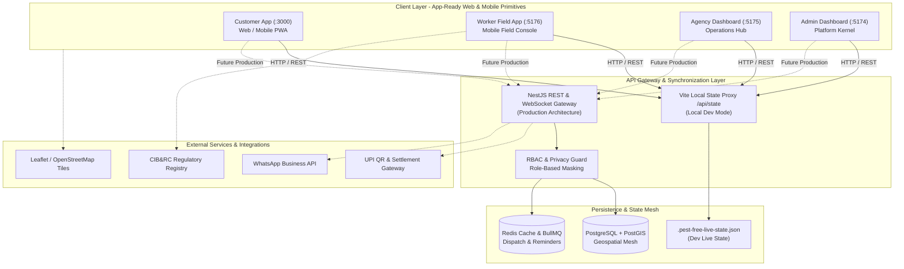

# Easy HiCare — System Architecture & Subsystem Boundaries

## 1. High-Level Architecture Overview

Easy HiCare is architected as an event-driven, multi-portal on-demand operations platform. It unifies customer booking, worker field execution, franchise operations, and platform governance into a synchronized monorepo.

---

## 2. Subsystem Breakdown & Roles

### 1. Customer Experience Subsystem (`apps/customer-app` — Port 3000)
- **4-Step Booking Engine:** Service selection (Cockroach, Termite, Bedbug, Rodent, Mosquito, Sanitization), premises sizing (BHK/SqFt), plan frequency, and calendar slot selection.
- **Dynamic Pricing Engine:** Instant calculations powered by `@pest-free/shared-utils/pricing.js`, factoring in area multipliers, base costs, GST (18%), and annual shield discounts.
- **Real-Time GPS Radar:** Leaflet-based radar showing live technician approach, estimated arrival window, and vehicle telemetry.
- **Doorstep Verification:** Displays 4-digit arrival OTP to provide to the technician; unlocks the mandatory post-service review modal before providing the completion PIN.

### 2. Technician Execution Console (`apps/worker-app` — Port 5176)
- **Dispatch Queue:** Instant notification of newly assigned bookings with turn-by-turn route preview.
- **Privacy Masking:** Real customer contact numbers and apartment addresses remain masked until the job state moves to `ARRIVED`.
- **Chemical Safety Checklist:** Mandatory checklist verifying CIB&RC odorless formulations, PPE gear, and chemical dosage before initiating treatment.
- **OTP Keypad:** Interactive tactile keypad with audio feedback to validate the customer's arrival OTP.
- **UPI QR Collection:** Dynamically rendered UPI QR code allowing instant customer scan-to-pay before job signoff.

### 3. Franchise & Agency Operations Portal (`apps/agency-dashboard` — Port 5175)
- **Bangalore Ops Radar:** Live map visualizing active field technicians, unassigned booking clusters, and real-time transit status.
- **Technician KYC Queue:** Document verification pipeline approving government pest control applicator licenses and background checks.
- **Chemical Inventory Tracking:** Real-time stock volume indicators preventing technicians from accepting jobs without adequate certified formulation stocks.
- **Two-Step Approval Gate:** Agency manually verifies booking suitability before assigning technicians and authorizing full customer address visibility.

### 4. Super-Admin Platform Kernel (`apps/admin-dashboard` — Port 5174)
- **Platform Engine Toggles:** Live kill-switches for auto-dispatch algorithms, dynamic pricing surges, and chemical compliance locks.
- **PII Cryptographic Tokenization Vault:** Audit log inspecting masked vs unmasked customer data disclosures.
- **PostGIS Geospatial Inspector:** Density mesh monitoring zone-wise coverage and technician allocation.

---

## 3. Communication Protocols

| Interface | Protocol | Purpose | Payload Format |
|---|---|---|---|
| **Client ↔ Dev State** | HTTP REST (GET/POST) | Fetch and mutate `.pest-free-live-state.json` via `/api/state` | JSON |
| **Cross-Tab Store Sync** | Custom Event / Storage Event | Instant Zustand store update across browser tabs | In-memory JSON |
| **Maps & Radar** | HTTPS Tiles | OpenStreetMap / Leaflet tile retrieval | PNG Raster / GeoJSON |
| **Production Real-Time** | WebSocket (Socket.IO) | Bidirectional technician coordinate streaming and dispatch alerts | GeoJSON / Binary |
| **Background Jobs** | BullMQ / Redis | Scheduled reminders (WhatsApp/SMS) and state timeout escalations | JSON |

---

## 4. Scalability, Resilience & Security Boundaries

### A. Privacy & Data Tokenization
- Technicians never receive raw customer phone numbers during dispatch. All telephony and address data is masked with `*` wildcards.
- Customer location coordinates are jittered until the agency owner confirms the assignment.

### B. Chemical Regulatory Compliance
- CIB&RC compliance validation is hardcoded into the booking lifecycle. Jobs cannot enter `IN_PROGRESS` or `COMPLETED` without technician confirmation of non-toxic, odorless certified batches.

### C. State Machine Resilience
- Booking state transitions are strictly deterministic. Invalid state mutations (e.g., trying to complete a booking that has not arrived or passed the OTP check) are rejected by `@pest-free/shared-utils/booking.js`.

### D. Zero-Dependency Production Packaging
- All 4 frontends compile into static bundles (`dist/`) that can be deployed onto CDN edge locations, achieving sub-100ms first paint times globally.
