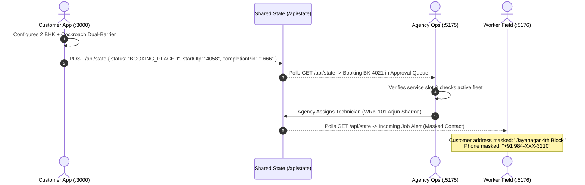
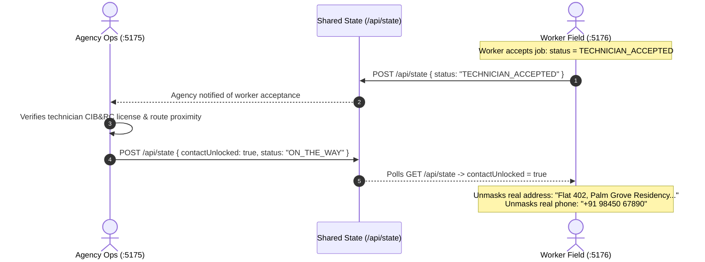
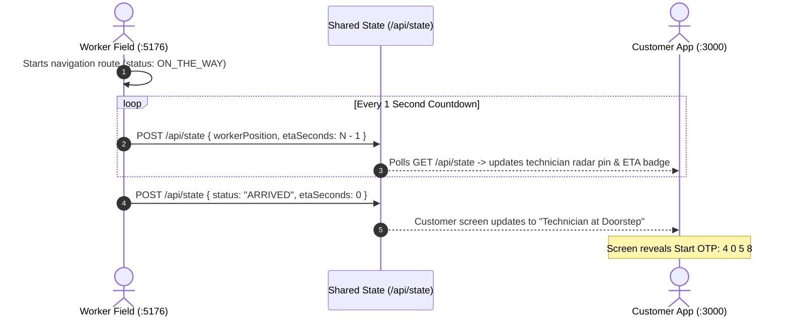
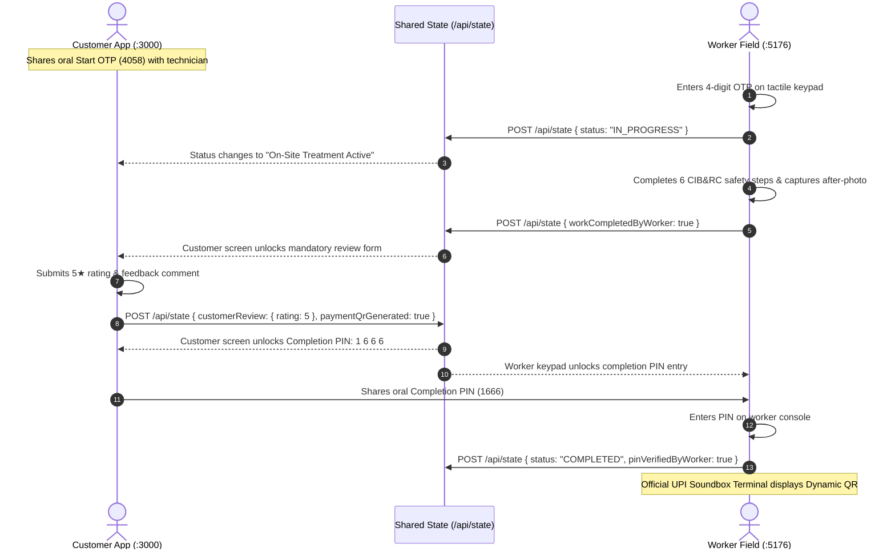
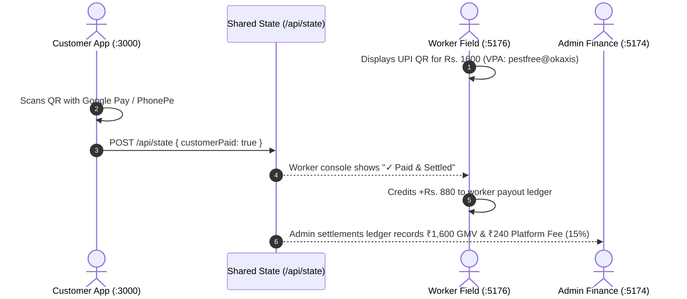

# Easy HiCare — Comprehensive Frontend & Backend Architecture Audit Report

**Document Version:** 1.0.0-FINAL  
**Auditor:** Principal Software Architect & Technical Auditor  
**Audit Scope:** Read-Only Technical Inspection of Applications (`apps/`), Shared Packages (`packages/`), Infrastructure Runners, State Sinks, and Backend Requirements  
**Repository Working Directory:** `c:\Users\ajith\Downloads\Pest_Fast1-main\Pest_Fast1-main`  
**Date of Audit:** October 24, 2026  
**Companion Documents:**
- [`docs/REPORT_PART_2_UI_INVENTORY.md`](file:///c:/Users/ajith/Downloads/Pest_Fast1-main/Pest_Fast1-main/docs/REPORT_PART_2_UI_INVENTORY.md) (Complete Exhaustive UI Element & Form Inventory for all 4 Dashboards)

---

## SECTION 1 — Executive Overview

### 1.1 Platform Purpose in Plain Language
Easy HiCare (internally branded in legacy artifacts as "Pest Free") is an on-demand, single-agency pest management and chemical extermination operations platform for metropolitan India (specifically configured for Bengaluru South and Central). 

The platform connects four key personas through a synchronized monorepo:
1. **Property Owners & Commercial Tenants (Customers):** Discover certified pest treatments, calculate transparent itemized quotes (featuring multi-service bundling and 18% GST), schedule slots, track arriving technicians with real-time OpenStreetMap GPS radar, verify technician identity at the doorstep via a 4-digit arrival OTP, complete mandatory post-service reviews, unlock the completion security PIN, and settle payments instantly via dynamic UPI QR soundbox terminals.
2. **Field Applicators & Technicians (Workers):** Receive instant dispatch alerts, access masked customer contact information (unmasked only upon arrival clearance), review turn-by-turn routes, verify arrival via customer OTP, complete mandatory government-certified CIB&RC 6-step chemical safety protocols, upload after-treatment photo proof, verify completion PINs, collect UPI/Cash settlements, and trigger instant IMPS earnings payouts.
3. **Franchise Owners & Operations Managers (Agency):** Supervise citywide technician fleets on an operations radar map, inspect chemical inventory stock quotas (ensuring non-toxic odorless compliance), process technician KYC licenses and police verification dossiers, approve incoming bookings, and enforce the platform's signature **two-step customer contact release gate**.
4. **Platform Super-Administrators & Core Engineers (Admin Kernel):** Oversee global platform telemetry, manage live feature toggles and kill-switches (auto-dispatch, 500m geofencing, maintenance mode), inspect the AES-256-GCM cryptographic PII tokenization vault, monitor WebSocket telemetry streams, inspect PostGIS spatial clustering indices, audit agency KYC filings, and resolve customer warranty disputes.

---

### 1.2 Current Architecture & Maturity Level

```
┌─────────────────────────────────────────────────────────────────────────────────────────────┐
│                                    CURRENT MATURITY: PHASE 1                                 │
│                                (LOCAL SIMULATION & CLIENT MESH)                              │
├────────────────────────────────┬───────────────────────────────┬────────────────────────────┤
│           REAL (WORKING)       │        MOCKED / LOCAL STATE   │      PLANNED FOR PROD      │
├────────────────────────────────┼───────────────────────────────┼────────────────────────────┤
│ • 4 Responsive React 19 SPAs   │ • `.pest-free-live-state.json`│ • NestJS REST Gateway      │
│ • Pure JS Monorepo (No TS)     │   file acts as single DB      │   (`apps/api` - empty)     │
│ • Dynamic Pricing + 18% GST    │ • Vite dev server proxy at    │ • PostgreSQL 16 + PostGIS   │
│ • Multi-Service 15% Bundling   │   `/api/state` with file lock │   spatial indexing         │
│ • Deterministic State Machine  │ • Polling interval (3000ms)   │ • Redis 7 + BullMQ queue   │
│ • 28 Vitest Unit Tests Passing │ • Simulated worker GPS steps  │ • Bidirectional Socket.IO  │
│ • Leaflet & OpenStreetMap Radar│ • Hardcoded UPI VPA endpoint  │ • Real RazorpayX / Cashfree│
│ • CIB&RC Chemical Sheets & Q&A │ • Mock KYC dossiers & licenses│ • e-KYC (DigiLocker / PAN) │
│ • App-Ready Layout Primitives  │ • Mocked AI Smart Quote logic │ • WhatsApp Business API    │
└────────────────────────────────┴───────────────────────────────┴────────────────────────────┘
```

The platform currently operates in a **high-fidelity local synchronization mode**. The frontends are 100% functional, responsive, and cross-synchronized via HTTP polling against an atomic state file (`.pest-free-live-state.json`) managed by Vite dev server middlewares. No actual production database (`apps/api` is currently an empty directory containing only documentation) or live third-party gateway (UPI, WhatsApp, e-KYC) is wired.

---

## SECTION 2 — Per-Dashboard Deep Dive

### 2.1 Customer Web Application (`apps/customer-app`)

- **Purpose & Target User:** Self-service treatment configurator, live tracking radar, and payment terminal for residential and commercial property owners.
- **Port:** Default `:3000` (or dynamically assigned by `dev.mjs` if occupied).
- **Base Route:** `/` or `/customer`.
- **Entry Files:**
  - `apps/customer-app/src/main.jsx` (React 19 root bootstrap)
  - `apps/customer-app/src/App.jsx` (`UnifiedPortalApp` route resolver)
  - `apps/customer-app/src/CustomerView.jsx` (Core customer shell, sidebar, modals, topbar)
  - `apps/customer-app/src/lib/api/store.js` (Zustand client store & live sync client)

#### Route & Section Map
| Route Path | Component | Target Role | Access Conditions |
|---|---|---|---|
| `/` or `/customer` (Section `home`) | `CustomerView.jsx` (Hero Landing) | Public / Property Owners | Default unauthenticated landing page |
| `/customer` (Section `book`) | `BookSection.jsx` | Property Owners | Clicked "Book Treatment" or "Book a Demo" CTA |
| `/customer` (Section `track`) | `TrackSection.jsx` | Property Owners | Active booking exists or manually navigated |
| `/customer` (Section `history`) | `HistorySection.jsx` | Existing Customers | Navigated via sidebar or post-payment redirect |
| `/customer` (Section `safety`) | `SafetyGuideSection.jsx` | Property Owners | Navigated via sidebar |

#### Screen-by-Screen Breakdown
1. **Hero Landing Page (`CustomerView.jsx:468-707`):**
   - Brand navbar with Easy HiCare logo, CIB&RC certification badge, and 24x7 helpline button.
   - Dynamic top banner indicating active booking in progress (if booking exists in store).
   - Headline: "Easy HiCare Pest Control — India's Most Trusted Certified Pest Solutions".
   - Showcase banner image: `/assets/services/house-spraying-hero.png`.
   - 4 Trust KPI cards: 50,000+ Homes Treated, 99.4% Customer Satisfaction, 120+ Licensed Applicators, 100% CIB&RC Registered.
   - Primary Call to Action: `Book a Demo / Book Treatment →`.
2. **Customer Workspace Shell (`CustomerView.jsx:710-936`):**
   - Collapsible left sidebar (`web-sidebar`) with verified customer profile card (Aarav Sharma), agency verification badges, 4 navigation items with dynamic pill count badges, logout button, and 24x7 emergency helpline CTA.
   - Sticky topbar (`web-topbar`) with hamburger toggle, Easy HiCare logo, license numbers, and online technician live indicator.
3. **Step 1 to 5 Booking Configurator (`BookSection.jsx`):**
   - Service Multi-Select: 6 pest options with base price badges, images, and chemical formulas.
   - Property Size: 1 BHK (1.0x) to Commercial (2.5x).
   - Treatment Plan: Standard (30d warranty), Barrier (90d warranty, +40%), Shield (365d warranty, +140%).
   - Dynamic Smart Quote Box: Evaluates pest severity and property size, suggesting optimal plan.
   - Slot & Dispatch Mode: Day picker (Today, Tomorrow, Weekend), Time window, Treat on Arrival vs Inspection First.
   - Service Address & Doorstep GPS Pin: Textarea, saved address chips, browser Geolocation capture (`captureLiveGps`), and coordinate display.
   - Sticky Live Quote Summary: Subtotal, 15% multi-service discount, 18% GST breakdown, total payable, and "Confirm & Book Treatment →" submit button.
4. **Live Radar & Doorstep Handshake (`TrackSection.jsx`):**
   - OpenStreetMap Radar: Leaflet radar map (`CustomerRadarMap.jsx`) rendering customer coordinate pin, technician GPS position marker, and dynamic polyline route.
   - Live Technician Safety Protocol Feed: Renders real-time completion state of 6 technician checklist steps.
   - Doorstep Treatment Start OTP Card: Displays masked dots `••••` until technician marks "I Have Arrived", whereupon 4-digit code (`4058`) is unlocked.
   - End-of-Service Completion Security PIN Card: Displays locked state until technician completes work; unlocks 5-star rating & review form; upon review submission, unlocks 4-digit PIN (`1666`).
   - Assigned Technician Card: Name (Arjun Sharma), rating (4.92★), CIB&RC license (`CHL-2024-889`), masked/unmasked phone, direct call button, and dynamic cancel button (`canCancel()`).
   - Payment Card & QR Modal: Triggers dynamic UPI QR generation modal (`upi://pay?pa=pestfree@okaxis...`), transaction confirmation, and automatic warranty generation.
5. **History & Warranty Vault (`HistorySection.jsx`):**
   - 3 KPI metric tiles: Total Treatments, Active Warranty Cover, Homeowner Loyalty Tier.
   - Past Bookings Table: Lists booking IDs, treatments, addresses, technicians, amounts, statuses, and ratings.
   - Warranty Certificate Modal: Generates printable CIB&RC Chemical Treatment & Warranty Certificate.
   - 1-Click Rebook: Pre-fills `rebookDraft` in Zustand store and redirects to booking form.
6. **Chemical Transparency Guide (`SafetyGuideSection.jsx`):**
   - Interactive CIB&RC Data Sheets: Detailed tabs for Deltamethrin 2.5% EC, Imidacloprid 30.5% SC, and Fipronil 0.05% Gel.
   - 6-step homeowner preparation and post-care safety checklist.

*(Refer to [`docs/REPORT_PART_2_UI_INVENTORY.md`](file:///c:/Users/ajith/Downloads/Pest_Fast1-main/Pest_Fast1-main/docs/REPORT_PART_2_UI_INVENTORY.md) Section 1 for the exhaustive 54-row element inventory and form schema).*

---

### 2.2 Technician Field Application (`apps/worker-app`)

- **Purpose & Target User:** Real-time job acceptance, navigation, safety verification, and doorstep collection console for certified applicators.
- **Port:** Default `:5176`.
- **Base Route:** `/` or `/technician` / `/worker`.
- **Entry Files:**
  - `apps/worker-app/src/main.jsx`
  - `apps/worker-app/src/App.jsx` (Core worker navigation, topbar, modals)
  - `apps/worker-app/src/lib/api/store.js` (Worker Zustand store & live synchronizer)

#### Route & Section Map
| Section ID | Component | Target Role | Access Conditions |
|---|---|---|---|
| `overview` | `WorkerOverviewSection.jsx` | Field Technician | Default view upon logging in |
| `workspace` | `ActiveJobWorkspaceSection.jsx` | Field Technician | Navigated via sidebar or "Continue & Navigate" |
| `route` | `RouteSection.jsx` | Field Technician | Historical & upcoming stops roster |
| `earnings` | `EarningsSection.jsx` | Field Technician | Financial ledger & instant payout gateway |
| `safety` | `SafetySection.jsx` | Field Technician | CIB&RC chemical safety reference library |

#### Screen-by-Screen Breakdown
1. **Technician Overview & Gate (`WorkerOverviewSection.jsx`):**
   - Header with active duty status switch (`ON DUTY` / `OFF DUTY`).
   - Timeframe metrics: Jobs completed, acceptance rate (99.4%), safety score (100%).
   - Customer Contact & Address Gate Card: Demonstrates privacy enforcement. When locked, displays `Aarav S.` and `+91 984-XXX-3210`. Includes button `Grant Agency Clearance (Simulate Step 1)` to unlock real contact details.
   - Action Buttons: `Continue & Navigate to Location →` (opens dedicated console) and `Decline & Release`.
   - Queued Jobs Roster: Displays upcoming assigned bookings (`JOB-9021`, `JOB-9022`).
   - Verified Applicator Dossier Card: Shows Arjun Sharma's photo, license code, and masked Aadhaar.
2. **Dedicated Execution Console (`ActiveJobWorkspaceSection.jsx`):**
   - Split layout: OpenStreetMap turn-by-turn navigation on the left (`WorkerMiniMap.jsx`), multi-stage execution wizard on the right.
   - Stage 1 — En Route & Arrival: Live ETA countdown with `Skip Timer` button and primary CTA `I Have Arrived at Doorstep`.
   - Stage 2 — Doorstep Start OTP Verification: 4-digit tactile keypad with audio feedback, `Auto-Fill Customer OTP` shortcut, and `Verify Start OTP` verification guard.
   - Stage 3 — CIB&RC Chemical Protocol: Mandatory 6-step interactive checklist, `Check All 6 Steps` shortcut, `Capture After-Treatment Photo Proof` simulator, and `Complete My Work & Request Customer Review` trigger.
   - Stage 4 — Completion PIN & Rating Handshake: 4-digit input for customer completion PIN (`1666`), `Auto-Fill PIN (1666)` shortcut, `Simulate Customer 5★ Review` fallback, and `Verify Completion PIN & Unlock Payment QR`.
   - Stage 5 — Official UPI Soundbox Terminal: Renders dynamic QR code for `Rs. 1600` and primary CTA `Confirm Customer Payment Received (Cash/UPI)`.
3. **Route History & Stops (`RouteSection.jsx`):**
   - Completed Route History & Warranty Registry table: Past stops (PF-8810, PF-8824, PF-8842, PF-8859).
   - Displays warranty expiration dates and job completion certificates.
4. **Earnings & Instant UPI Payout (`EarningsSection.jsx`):**
   - 3 earnings tiles: Today (`Rs. 1,050`), This Week (`Rs. 5,250`), This Month (`Rs. 21,400`).
   - Primary action: `Request Instant UPI IMPS Transfer (Rs. {today})`. Simulates instant IMPS settlement to registered VPA (`arjun.sharma@okaxis`) with random UTR generation.
   - Settlement History Table: Lists past disbursements with UTR numbers and timestamps.
5. **Safety Hub & AI Assistant (`SafetySection.jsx`):**
   - Full-text CIB&RC safety sheets for Deltamethrin, Imidacloprid, Fipronil.
   - Floating AI assistant button opening modal backed by `answerWorkerSafetyQuestion`.

*(Refer to [`docs/REPORT_PART_2_UI_INVENTORY.md`](file:///c:/Users/ajith/Downloads/Pest_Fast1-main/Pest_Fast1-main/docs/REPORT_PART_2_UI_INVENTORY.md) Section 2 for the exhaustive 44-row element inventory and form schema).*

---

### 2.3 Franchise & Agency Operations Portal (`apps/agency-dashboard`)

- **Purpose & Target User:** Franchise dispatch management, worker KYC vetting, chemical inventory control, and customer contact unmask authorization.
- **Port:** Default `:5175`.
- **Base Route:** `/` or `/agency`.
- **Entry Files:**
  - `apps/agency-dashboard/src/main.jsx`
  - `apps/agency-dashboard/src/App.jsx` (Authentication boundary and route switch)
  - `apps/agency-dashboard/src/pages/Dashboard.jsx` (Core operations dashboard)
  - `apps/agency-dashboard/src/pages/WorkerFleet.jsx` (Fleet roster & license management)

#### Route Map
| Route Path | Component | Target Role | Access Conditions |
|---|---|---|---|
| `/` or `/agency` | `Dashboard.jsx` | Agency Dispatcher / Franchise Owner | `isAuthenticated = true` |
| `/worker-fleet` or `/agency/worker-fleet` | `WorkerFleet.jsx` | Agency Dispatcher / Franchise Owner | `isAuthenticated = true` |
| Internal | `Login` (inline in `App.jsx`) | Unauthenticated User | Shown when `isAuthenticated = false` |

#### Screen-by-Screen Breakdown
1. **Dispatcher Sign-In Screen (`App.jsx:30-86`):**
   - EcoPest Solutions (Bangalore Hub #PF-8821) branding.
   - Form: Email (`agency@ecopest.com`), Password (`password123`), Submit button `Sign In to Dispatch Ops`.
2. **Operations Dashboard (`Dashboard.jsx`):**
   - KPI Bar: Active Dispatches (18 units), Avg Response Time (18.4 min), Fleet Trust Score (4.92★), Bio-Safe Chemical Stock (94.2% quota).
   - Interactive Bangalore Operations Radar: Visual map with Whitefield, Indiranagar, and Koramangala cluster nodes. Controls: `Recenter Node`, technician focus pins.
   - Priority Booking Approvals Queue: Lists pending bookings (BK-4021 to BK-4024). Includes critical two-step action: "Assign Tech" and "Release Contact".
   - Technician KYC & Onboarding Queue: Applications from Suresh Patil, Fatima Shaikh, Arun Nambiar. Action `Review Dossier` opens `WorkerKycDossierModal` with one-click `Approve & Deploy to Fleet` (which immediately injects the worker into the active roster).
   - Client Directory & Warranty Register: Client cards (Meera Venkatesh, Rohan Kulkarni) with `View Dossier` modal.
   - Chemical & Supply Ledger: Stock progress bars for Fipronil, Imidacloprid, Deltamethrin, Bromadiolone.
3. **Fleet Roster & Management (`WorkerFleet.jsx`):**
   - Status filters: All, Active, On Job, Offline.
   - Search bar and `Add New Technician` modal.
   - Detailed technician roster cards showing live telemetry, battery percentages, active job cards, and CIB&RC license validity.

*(Refer to [`docs/REPORT_PART_2_UI_INVENTORY.md`](file:///c:/Users/ajith/Downloads/Pest_Fast1-main/Pest_Fast1-main/docs/REPORT_PART_2_UI_INVENTORY.md) Section 3 for the exhaustive 34-row element inventory and form schema).*

---

### 2.4 Super-Admin Platform Kernel (`apps/admin-dashboard`)

- **Purpose & Target User:** Platform governance, kill-switches, PostGIS spatial queries, DPDP PII encryption audit, agency licensing, and dispute resolution.
- **Port:** Default `:5174`.
- **Base Route:** `/` or `/admin`.
- **Entry Files:**
  - `apps/admin-dashboard/src/main.jsx`
  - `apps/admin-dashboard/src/App.jsx` (Admin navigation, modal orchestrator, login)
  - `apps/admin-dashboard/src/pages/PlatformOverview.jsx` (Telemetry, PostGIS, PII, live fleet)
  - `apps/admin-dashboard/src/pages/KycTab.jsx` (Agency trade license vetting)
  - `apps/admin-dashboard/src/pages/DisputesTab.jsx` (Warranty breach escalations & SLA failure charts)
  - `apps/admin-dashboard/src/pages/FinancialsTab.jsx` (15% platform take-rate & RazorpayX escrow payouts)

#### Route & Tab Map
| Tab Key | Component | Target Role | Access Conditions |
|---|---|---|---|
| `telemetry` | `PlatformOverview.jsx` | Platform Super-Admin / Lead Engineer | `isAuthenticated = true` |
| `kyc` | `KycTab.jsx` | Compliance Officer / Super-Admin | `isAuthenticated = true` |
| `disputes` | `DisputesTab.jsx` | Quality Assurance / Dispute Arbitrator | `isAuthenticated = true` |
| `financials` | `FinancialsTab.jsx` | Platform Finance / Super-Admin | `isAuthenticated = true` |

#### Screen-by-Screen Breakdown
1. **Developer & Root Login Screen (`App.jsx:141-210`):**
   - High-security root authentication barrier with TOTP key simulation.
2. **System Core & Telemetry Mesh (`PlatformOverview.jsx`):**
   - Quick launch panel: `Manage Hubs`, `Inspect Vault`, `View Sockets`, `Launch Spatial Tool`, `Open Kernel Settings`.
   - Real-time KPI tiles: System Health (99.98% uptime, 184 ops/sec), PostGIS Geofence Velocity (22.4 km/h), PII Masking Enforcement (100% tokenized), API Gateway Latency (14ms).
   - Live Fleet Telemetry Table: 5 technicians (Anita Desai, Rajesh Kumar, Vikram Solanki, Devendra Singh, Pooja Hegde) with real battery telemetry, ping, GPS coordinates, Aadhaar hashes, and police verification IDs.
   - Interactive CSV Exporter: Generates `technicians_telemetry.csv`.
3. **Agency KYC Audits & Approved Network (`KycTab.jsx`):**
   - Pending Applications Queue: Apex Pest Bangalore (AGY-104), CleanShield NCR (AGY-105). Action: `Approve Agency & Issue License` (moves agency to approved list inline) and `Reject Application`.
   - Approved Agency Hubs Directory: EcoPest Solutions, Apex Pest, CleanShield with mTLS certificate status, technician count, and SLA performance.
4. **Disputes & SLA Compliance Desk (`DisputesTab.jsx`):**
   - Visual Stacked Bar Chart: Jobs Accomplished (98.0%) vs Failure Rate (2.0%).
   - Monthly trend comparison (June to October).
   - Customer Escalations Queue: Differentiates "Old Customer" (AMC high LTV) vs "New Customer" (promo user). Actions: `Issue Free Re-treatment`, `Issue ₹300 Courtesy Refund`, `Reject Claim`.
5. **Settlements, Escrow & GMV Ledger (`FinancialsTab.jsx`):**
   - Financial KPIs: Monthly GMV (₹4,44,500), Platform Take-Rate 15% (₹66,675), Agency Net Settlements (₹3,77,825).
   - Actions: `Disburse Weekly Payouts` (batch IMPS settlement) and `Pay Now via IMPS` for individual agencies via simulated RazorpayX API.
6. **Platform Modals (`AdminModals.jsx`):**
   - `SystemConfigModal`: Live toggles for Geo-Lock Enforcement, Auto-Dispatch Engine, Webhooks, Fraud Detection, Maintenance Mode, Beta Features. Buttons: `Save Settings`, `Flush Cache` (clears 2,840 Redis keys).
   - `PiiVaultModal`: Demonstrates AES-256-GCM redaction under DPDP Act 2023. Toggle `Authorize Decrypt` reveals plaintext Aadhaar and mobile numbers for Level-3 root audit. Button `Download Compliance Audit Dossier` exports encrypted JSON audit log. Button `Rotate KMS Key` generates new entropy.
   - `StreamsModal`: Socket.IO inspector with live packet terminal log. Controls: Throttle rates (`1s Turbo`, `5s Standard`, `10s Eco`), `Pause Stream`, `Clear Log`, `Flush Socket Buffer`, `Emit Test Ping`.
   - `PostGisModal`: Executes raw PostGIS `ST_DWithin` and `ST_Distance` SQL queries across radius options (5.0, 8.5, 12.0, 15.0 km). Displays nearest 3 technicians sorted by distance. Button `Reindex GiST Spatial Mesh` executes `REINDEX TABLE fleet_technicians`.

*(Refer to [`docs/REPORT_PART_2_UI_INVENTORY.md`](file:///c:/Users/ajith/Downloads/Pest_Fast1-main/Pest_Fast1-main/docs/REPORT_PART_2_UI_INVENTORY.md) Section 4 for the exhaustive 55-row element inventory and form schema).*

---

## SECTION 3 — Cross-Dashboard Connection Map

### 3.1 State Synchronization Reactive Matrix

All 4 portals currently synchronize their distributed state via HTTP polling against `/api/state`, hosted by the Vite dev server proxy in `apps/customer-app/vite.config.js`.

| Triggering Action (App X) | State Changed | Synchronizer Triggered | Reacting Portal (App Y/Z) | Reaction / UI Update in App Y/Z | Synchronization Latency |
|---|---|---|---|---|---|
| Customer confirms booking (`BookSection.jsx:152`) | `booking`, `startOtp = '4058'`, `completionPin = '1666'` | `POST /api/state` | Worker App (`:5176`) | `incomingJob` card appears on Worker Overview with masked contact details | ~3000ms (Next poll cycle) |
| Customer confirms booking (`BookSection.jsx:152`) | `booking.status = 'BOOKING_PLACED'` | `POST /api/state` | Agency Dashboard (`:5175`) | Booking appears in Priority Approvals Queue | ~3000ms |
| Agency approves booking (`Dashboard.jsx:50`) | `booking.status = 'AGENCY_APPROVED'`, `assignedWorker` | In mock: simulated via worker/customer store | Customer App (`:3000`) | Radar updates from "Searching" to "Dispatched • Technician Assigned" | ~3000ms |
| Agency grants contact clearance (`WorkerOverviewSection.jsx:110`) | `contactUnlocked = true` | `POST /api/state` | Worker App (`:5176`) | Unmasks customer phone (`+91 98450 67890`) and street address | Instant (Store) / 3000ms (Cross-port) |
| Worker clicks "I Have Arrived" (`ActiveJobWorkspaceSection.jsx:210`) | `booking.status = 'ARRIVED'`, `etaSeconds = 0` | `POST /api/state` | Customer App (`:3000`) | Radar status changes to "Technician at Doorstep"; **Start OTP (`4058`) reveals on screen** | ~3000ms |
| Worker verifies Start OTP (`ActiveJobWorkspaceSection.jsx:79`) | `booking.status = 'IN_PROGRESS'` | `POST /api/state` | Customer App (`:3000`) | Status changes to "On-Site Treatment Active"; live checklist feed activates | ~3000ms |
| Worker clicks "Complete My Work" (`ActiveJobWorkspaceSection.jsx:45`) | `workCompletedByWorker = true` | `POST /api/state` | Customer App (`:3000`) | Review form unlocks: prompts customer for 1–5 star rating | ~3000ms |
| Customer submits review (`TrackSection.jsx:410`) | `customerReview`, `paymentQrGenerated = true` | `POST /api/state` | Customer App & Worker App | Customer screen reveals **Completion PIN (`1666`)**; Worker App unlocks PIN keypad | ~3000ms |
| Worker verifies Completion PIN (`ActiveJobWorkspaceSection.jsx:108`) | `booking.status = 'COMPLETED'`, `pinVerifiedByWorker = true` | `POST /api/state` | Worker App & Customer App | Worker App displays Official Soundbox UPI QR; Customer App unlocks payment modal | ~3000ms |
| Customer confirms payment (`TrackSection.jsx:651`) | `customerPaid = true`, `booking = null` | `POST /api/state` | Worker App (`:5176`) | Displays "✓ Paid & Settled"; increments today's earnings by `payout` | ~3000ms |
| Customer detects live GPS (`BookSection.jsx:92`) | `liveCustomerLocation = {lat, lng}` | `POST /api/state` | Worker App (`:5176`) | WorkerMiniMap recalculates turn-by-turn route to customer pin | ~3000ms |
| Admin toggles Maintenance Mode (`AdminModals.jsx:63`) | `vals.maintenanceMode` | Local React State (Mock) | Customer App (`:3000`) | In production: API gateway returns 503; in mock: **unwired** | UNVERIFIED in mock |

---

### 3.2 Mermaid Cross-Dashboard Sequence Diagrams

#### Flow A: Booking Creation → Agency Approval → Worker Dispatch


#### Flow B: Two-Step Privacy Gate & Contact Release


#### Flow C: Worker Transit & Live Radar Tracking


#### Flow D: Doorstep Verification, Safety Protocol, Review Gate & Completion


#### Flow E: UPI Dynamic QR Generation & Settlement


---

### 3.3 "Who Writes / Who Reads" Live State Map

Source of Truth: `.pest-free-live-state.json`

| Key / Field Name | Primary Writer | Secondary Writers | Primary Readers | Consuming Components |
|---|---|---|---|---|
| `booking.id` | Customer App | Worker App (Simulation) | Customer, Worker, Agency | `CustomerView`, `TrackSection`, `ActiveJobWorkspaceSection` |
| `booking.status` | Customer App (`BOOKING_PLACED`, `CANCELLED`) | Worker App (`ARRIVED`, `IN_PROGRESS`, `COMPLETED`), Agency Dashboard | All 4 Apps | `TrackSection`, `ActiveJobWorkspaceSection`, `Dashboard.jsx`, `PlatformOverview.jsx` |
| `booking.pestType` / `pestTypes` | Customer App (`placeBooking`) | Worker App (Simulation) | Worker App, Customer App | `BookSection`, `TrackSection`, `WorkerOverviewSection` |
| `booking.price` / `pricing` | Customer App (`calculateMultiServicePrice`) | Worker App (Simulation) | Customer, Worker, Admin | `TrackSection`, `ActiveJobWorkspaceSection`, `FinancialsTab` |
| `startOtp` | Customer App (`placeBooking` sets `'4058'`) | Customer Store (`'4058'`) | Customer App, Worker App | Revealed on `TrackSection` when ARRIVED; verified in `ActiveJobWorkspaceSection` |
| `completionPin` | Customer App (`placeBooking` sets `'1666'`) | Worker App (`'1666'`) | Customer App, Worker App | Revealed on `TrackSection` after review; verified in `ActiveJobWorkspaceSection` |
| `contactUnlocked` | Agency Dashboard / Worker Overview (`Grant Agency Clearance`) | Customer App (`simulateCustomerStage`) | Worker App | `WorkerOverviewSection`, `ActiveJobWorkspaceSection` (Controls address masking) |
| `workCompletedByWorker` | Worker App (`workerMarkWorkFinished`) | Worker App (`checkAllSafetySteps`) | Customer App | `TrackSection` (Unlocks review submission modal) |
| `pinVerifiedByWorker` | Worker App (`workerVerifyCustomerCompletionPin`) | None | Customer App, Worker App | `TrackSection`, `ActiveJobWorkspaceSection` |
| `paymentQrGenerated` | Customer App (`submitCustomerReview`) | Worker App (`workerVerifyCustomerCompletionPin`) | Customer App, Worker App | Unlocks QR code modal in `TrackSection` and terminal in `ActiveJobWorkspaceSection` |
| `customerPaid` | Customer App (`confirmCustomerPayment`) | Worker App (`workerConfirmPaymentReceived`) | Customer, Worker, Admin | Updates status to Paid & Settled; credits worker ledger |
| `customerReview` | Customer App (`submitCustomerReview`) | Worker App (`workerSimulateCustomerReview`) | Customer, Worker, Admin | Displays review feedback; unlocks completion PIN |
| `etaSeconds` | Customer App / Worker App (`_startEtaCountdown`) | Worker App (`fastForwardEta` sets `0`) | Customer App, Worker App | Renders countdown badge on customer radar & worker navigation bar |
| `liveCustomerLocation` | Customer App (`captureLiveGps`) | Customer Profile Modal | Worker App | Pinned in `CustomerRadarMap` and destination in `WorkerMiniMap` |
| `workerPosition` | Customer App / Worker App (`_startWorkerMovement`) | Worker App Telemetry | Customer App | Live moving icon on `CustomerRadarMap` |
| `assignedWorker` | Customer Store (`MOCK_WORKERS[0]`) | Agency Dashboard | Customer App | Displays technician photo, license, phone in `TrackSection` |
| `incomingJob` | Customer App (`placeBooking`) | Worker App (Simulation) | Worker App | Renders incoming job dispatch card in `WorkerOverviewSection` |

---

## SECTION 4 — Booking State Machine & Business Rules

### 4.1 Implemented State Machine (`packages/shared-utils/booking.js`)

Transitions are strictly validated through the `transitionBooking` utility function. Any unauthorized jump throws an instance of `InvalidTransitionError`.

```
                    ┌──────────────────┐
                    │  BOOKING_PLACED  │
                    └────────┬─────────┘
                             │
                      AGENCY_APPROVE
                             │
                             ▼
                    ┌──────────────────┐
                    │ AGENCY_APPROVED  │
                    └────────┬─────────┘
                             │
                       WORKER_ACCEPT
                             │
                             ▼
                    ┌─────────────────────┐
                    │ TECHNICIAN_ACCEPTED │
                    └────────┬────────────┘
                             │
                    OWNER_UNLOCK_CONTACT
                             │
                             ▼
                    ┌──────────────────┐
                    │    ON_THE_WAY    │
                    └────────┬─────────┘
                             │
                       WORKER_ARRIVE (Guarded: etaSeconds == 0 && ownerUnlockedContact)
                             │
                             ▼
                    ┌──────────────────┐
                    │     ARRIVED      │
                    └────────┬─────────┘
                             │
                   VERIFY_OTP_AND_START (Guarded: otp == startOtp)
                             │
                             ▼
                    ┌──────────────────┐
                    │   IN_PROGRESS    │
                    └────────┬─────────┘
                             │
                   COMPLETE_TREATMENT (Guarded: 6 safety steps verified && afterPhotoDataUrl)
                             │
                             ▼
                    ┌──────────────────┐
                    │    COMPLETED     │
                    └──────────────────┘
```

#### Transition Legality & Error Table
| Source Status | Event / Trigger | Target Status | Pre-Conditions / Guards | Exact Error Thrown on Illegal Attempt |
|---|---|---|---|---|
| Any non-`BOOKING_PLACED` | `AGENCY_APPROVE` | `AGENCY_APPROVED` | Booking must be in `BOOKING_PLACED`; verified worker must be available | `Cannot approve booking from status {status}. Must be BOOKING_PLACED.` or `No available KYC-verified worker found.` |
| Any non-`AGENCY_APPROVED` | `WORKER_ACCEPT` | `TECHNICIAN_ACCEPTED` | Booking must be in `AGENCY_APPROVED` | `Worker cannot accept job in status {status}. Must be AGENCY_APPROVED.` |
| Any non-`TECHNICIAN_ACCEPTED` | `PING_OWNER_WHATSAPP` | No change | Status must be `TECHNICIAN_ACCEPTED` | `Can only ping owner for contact unlock in TECHNICIAN_ACCEPTED status.` |
| Any non-`TECHNICIAN_ACCEPTED` | `OWNER_UNLOCK_CONTACT` | `ON_THE_WAY` | Status must be `TECHNICIAN_ACCEPTED` | `Owner can only grant second permission after worker accepts (current: {status}).` |
| Any non-`ON_THE_WAY` | `TICK_ETA` | No change | Status must be `ON_THE_WAY` | `Cannot tick ETA when status is {status}.` |
| Any non-`ON_THE_WAY` | `WORKER_ARRIVE` | `ARRIVED` | Status must be `ON_THE_WAY`; `ownerUnlockedContact === true`; `etaSeconds === 0` | `Worker can only mark arrived from ON_THE_WAY (current: {status}).` or `Worker cannot arrive before owner grants second permission.` or `Worker cannot mark arrived until ETA finishes ({etaSeconds}s remaining).` |
| Any non-`ARRIVED` | `VERIFY_OTP_AND_START` | `IN_PROGRESS` | Status must be `ARRIVED`; `event.otp.trim() === booking.startOtp` | `Cannot start treatment before worker arrives (current: {status}).` or `Incorrect 4-digit start OTP. Ask the customer for the code on their Track screen.` |
| Any non-`IN_PROGRESS` | `TOGGLE_SAFETY_STEP` | No change | Status must be `IN_PROGRESS` | `Safety checklist can only be updated during IN_PROGRESS (current: {status}).` |
| Any non-`IN_PROGRESS` | `CAPTURE_AFTER_PHOTO` | No change | Status must be `IN_PROGRESS`; valid `dataUrl` provided | `After-photo can only be captured during IN_PROGRESS (current: {status}).` or `Valid photo proof is required.` |
| Any non-`IN_PROGRESS` | `COMPLETE_TREATMENT` | `COMPLETED` | All 6 safety steps must be `true`; `afterPhotoDataUrl` must exist | `Cannot complete treatment from status {status}. Must be IN_PROGRESS.` or `All 6 safety and protocol steps must be ticked before completing.` or `An after-treatment photo must be captured before completing.` |
| Status outside `BOOKING_PLACED`, `AGENCY_APPROVED`, `TECHNICIAN_ACCEPTED` | `CANCEL_BOOKING` | `CANCELLED` | Technician must not have departed (`ON_THE_WAY` or later) | `Cancellation is not allowed once the technician is {status}.` |
| Any non-`COMPLETED` | `RATE_BOOKING` | No change | Status must be `COMPLETED`; rating between 1 and 5 | `Can only rate a completed booking.` or `Rating must be between 1 and 5 stars.` |

---

### 4.2 Pricing Engine Formulas (`packages/shared-utils/pricing.js`)

1. **Single-Service Pricing (`calculatePrice`):**
   $$\text{Subtotal} = \text{round}(\text{Pest Base Price} \times \text{Size Multiplier} \times \text{Plan Multiplier})$$
   $$\text{GST} = \text{round}(\text{Subtotal} \times 0.18)$$
   $$\text{Total} = \text{Subtotal} + \text{GST}$$
   $$\text{Payable Now} = \begin{cases} 0 & \text{if dispatchMode} = \text{"inspection"} \\ \text{Total} & \text{if dispatchMode} = \text{"treat\_on\_arrival"} \end{cases}$$

2. **Multi-Service Pricing (`calculateMultiServicePrice`):**
   $$\text{Raw Sum} = \sum_{p \in \text{Selected Pests}} \text{BasePrice}(p)$$
   $$\text{Bundle Discount} = \begin{cases} \text{round}(\text{Raw Sum} \times 0.15) & \text{if } |\text{Selected Pests}| \ge 2 \\ 0 & \text{otherwise} \end{cases}$$
   $$\text{Effective Base} = \text{Raw Sum} - \text{Bundle Discount}$$
   $$\text{Subtotal} = \text{round}(\text{Effective Base} \times \text{Size Multiplier} \times \text{Plan Multiplier})$$
   $$\text{GST} = \text{round}(\text{Subtotal} \times 0.18)$$
   $$\text{Total} = \text{Subtotal} + \text{GST}$$

3. **Domain Multipliers (`packages/shared-config/constants.js`):**
   - **Pest Base Prices:** Cockroaches (₹799), Termites (₹1,499), Bedbugs (₹1,699), Rodents (₹999), Mosquitoes (₹699), Sanitization (₹1,199).
   - **Property Sizes:** 1 BHK (1.0x), 2 BHK (1.3x), 3 BHK (1.6x), 4+ BHK / Villa (2.1x), Commercial (2.5x).
   - **Treatment Plans:** Eco Standard (1.0x, 30d warranty), Dual-Layer Barrier (1.4x, 90d warranty), Annual 360° Shield (2.4x, 365d warranty).

4. **Deterministic Smart Quote Recommendation Engine (`generateSmartQuoteRecommendation`):**
   - Recommends **Annual 360° Shield** if `propertySize === 'commercial'` OR (`pestType === 'termites'` AND note contains severe keywords: *everywhere, months, recurring, heavy, severe, wood, furniture*).
   - Recommends **Dual-Layer Barrier** if `pestType === 'bedbugs'` OR `pestType === 'termites'` OR severe keywords present OR `propertySize` is `3bhk`/`4bhk`.
   - Recommends **Eco Standard** for all other mild or first-time sightings.

---

### 4.3 Worker Proximity & Dispatch Scoring (`scoreAndRankWorkers`)

The dispatch engine calculates a composite normalized score ($0 \dots 100$):
$$\text{Score} = \text{Distance Score (50\%)} + \text{Rating Score (35\%)} + \text{Load Score (15\%)}$$

Where:
- **Eligibility Filter:** Worker must satisfy `w.available === true && w.kycVerified === true`.
- **Distance Score (50 pts):**
  $$\text{DistanceKm} = \text{Haversine}(\text{worker.coords}, \text{target.coords})$$
  $$\text{DistanceScore} = \max\left(0, 50 \times \left(1 - \frac{\text{DistanceKm}}{15}\right)\right)$$
  *(Drop-off to 0 at 15 km).*
- **Rating Score (35 pts):**
  $$\text{RatingScore} = \max\left(0, \min\left(35, \frac{\text{w.rating} - 3.5}{1.5} \times 35\right)\right)$$
  *(Scaled linearly between 3.5★ and 5.0★).*
- **Load Score (15 pts):**
  $$\text{LoadScore} = \max\left(0, 15 \times \left(1 - \frac{\text{w.activeLoad}}{5}\right)\right)$$
  *(Penalizes workers with active concurrent assignments).*
- **Sort Priority:** Descending by `score`; secondary tie-breaker ascending by `distanceKm`.

---

### 4.4 Privacy Masking Security Audit (UI vs Real Data Masking)

> [!WARNING]
> **CRITICAL SECURITY FINDING: CLIENT-SIDE PII LEAKAGE IN CURRENT MOCK MESH**
>
> In the production architecture (`docs/backend-schema.md` and `docs/TRD.md`), the server must **never send raw customer contact info** to the worker client before the job state reaches `ARRIVED` / `contact_released`.
>
> **Current Code Reality:**
> 1. In `apps/customer-app/src/lib/api/store.js` line 68–70 and line 225, `placeBooking` constructs the state object containing `customerRealPhone: '+91 98765 43210'` and full address `Flat 402, Palm Grove Residency...`.
> 2. `syncRemote` broadcasts this raw payload directly to `/api/state`, writing it to `.pest-free-live-state.json`.
> 3. When `apps/worker-app` calls `fetchRemote()`, **the entire raw customer address and phone number are received in the worker browser's memory buffer** before the agency grants clearance.
> 4. `apps/worker-app/src/pages/WorkerOverviewSection.jsx` and `ActiveJobWorkspaceSection.jsx` use a **purely visual UI mask** (`contactUnlocked ? real : masked`). A malicious field worker inspecting the DevTools Network tab or `window.__WORKER_STORE__.getState().booking` can extract the customer's unmasked phone and address before arriving at the property.
>
> **Remediation for NestJS Backend:** The server-side serializer must project customer contact through a role-based DTO that strips `customerRealPhone` and `address` until the database record verifies `contact_releases` entry exists for that technician and booking.

---

## SECTION 5 — Shared Packages Audit

```
packages/
├── ui-kit/         -> Core UI primitives, buttons, cards, modals, maps
├── shared-hooks/   -> Custom React hooks (useToast, useMediaQuery)
├── shared-utils/   -> Pure math, pricing, formatting, booking state machine
├── shared-config/  -> Theme tokens, chemical sheets, domain constants
├── shared-types/   -> Data contracts (contains orphaned .ts files!)
├── api-client/     -> Universal /api/state sync client (contains 204 JSON bug)
└── db/             -> DB migrations & schema (currently empty README only)
```

### 5.1 Package Audit Matrix

| Package Name | Exported Symbols | Consuming Applications | Duplicate or Dead Code Identified | Bypasses & Anti-Patterns |
|---|---|---|---|---|
| `@pest-free/ui-kit` | `Button`, `Modal`, `ModalDialog`, `Card`, `StatCard`, `Badge`, `Alert`, `SectionHeader`, `RadarMap`, `ToastStack`, `Toast`, `View`, `Text`, `TouchableOpacity`, `TextInput`, `ScrollView`, `Image` | Customer App, Worker App, Agency Dashboard, Admin Dashboard | `ToastStack` is defined in `ui-kit/ToastStack.jsx`, but `CustomerView.jsx:36` and `worker-app/src/App.jsx:39` both reimplement an inline duplicate `ToastStack`! | Admin Dashboard and Agency Dashboard frequently use raw HTML `<button>`, `<div>`, and Tailwind utility classes instead of `@pest-free/ui-kit` primitives (`View`, `Text`). |
| `@pest-free/shared-hooks` | `useToast`, `useMediaQuery` | All 4 Apps | `useToast` is exported by `shared-hooks/useToast.js`, but `CustomerView.jsx:26` and `worker-app/src/App.jsx:29` reimplement private inline versions of `useToast()`. | Unused hook exports inside apps that chose to inline local hook state. |
| `@pest-free/shared-utils` | `calculatePrice`, `calculateMultiServicePrice`, `generateSmartQuoteRecommendation`, `scoreAndRankWorkers`, `createBookingFromInput`, `transitionBooking`, `InvalidTransitionError`, `formatCurrency`, `formatDistance`, `formatTimeSeconds`, `extractAreaFromAddress`, `answerWorkerSafetyQuestion`, `exportToCSV` | Customer App, Worker App, Agency Dashboard, Admin Dashboard | `exportToCSV` is exported in `shared-utils/export.js`, yet `admin-dashboard/src/pages/PlatformOverview.jsx:4-19` reimplements an inline duplicate `exportToCSV` function! | `safeTransition` in `customer-app/src/lib/api/store.js:16` catches and silences `InvalidTransitionError` with `catch (_) { return booking; }`, masking transition bugs during execution. |
| `@pest-free/shared-config` | `PEST_TYPES`, `PROPERTY_SIZES`, `TREATMENT_PLANS`, `PLANS`, `TIME_SLOTS`, `DAY_OPTS`, `SAVED_ADDRESSES`, `LIFECYCLE_STAGES`, `SAFETY_STEPS_TEMPLATE`, `SAFETY_CHECKLIST_STEPS`, `CANDIDATE_WORKERS`, `BUNDLED_CHEMICAL_SHEETS`, `colors`, `theme` | Customer App, Worker App, Agency Dashboard, Admin Dashboard | `apps/customer-app/src/constants.js` duplicates `PEST_IMAGES`, `DAY_OPTS`, `SAVED_ADDRESSES` with different formatting from `shared-config`. | Hex color strings (e.g., `#003527`, `#FFF4C2`, `#fea619`) are hardcoded directly in JSX styles instead of using `colors` or `theme` tokens. |
| `@pest-free/shared-types` | `mockServices`, `mockAgencies` (via `index.js`) | Only consumed by dev aliases | **CRITICAL:** Contains orphaned TypeScript files: `booking.ts`, `agency.ts`, `customer.ts`, `worker.ts`, `mock.ts`, `index.ts`. Violates repo rule: "Zero TypeScript". | Runtime frontends import from `@pest-free/shared-config` directly because `shared-types` only exports mock service cards. |
| `@pest-free/api-client` | `DEFAULT_API_URL`, `fetchLiveState`, `pushLiveState`, `resetLiveState` | Customer App, Worker App | **BUG in `pushLiveState`:** Line 32 calls `return await res.json()`. The Vite dev server responds with HTTP 204 No Content (empty body). Parsing JSON on an empty 204 throws an error, causing `pushLiveState` to return `null`! | `customer-app/src/lib/api/store.js` and `worker-app/src/lib/api/store.js` bypass `pushLiveState` and call `fetch('/api/state', { method: 'POST' ... })` directly. |
| `@pest-free/db` | None (`README.md` only) | None | Empty package containing only `README.md`. No Prisma schema, no TypeORM entities, no SQL migrations. | Documents say `packages/db` contains migrations; reality is zero migrations exist. |

---

## SECTION 6 — Current "Backend" (Mock) Behavior

### 6.1 Exact Mechanics of `/api/state`

The mock backend is implemented as a Vite dev server connect middleware plugin (`pest-free-api`) in `apps/customer-app/vite.config.js:14-106` (and mirrored in `apps/worker-app/vite.config.js:14-100`).

#### Endpoints
1. `GET /api/state`: Reads `.pest-free-live-state.json` from the monorepo root. Returns JSON representation of state. If file does not exist, returns `{}`.
2. `POST /api/state`: Receives JSON payload, reads existing `.pest-free-live-state.json`, performs a shallow merge with sticky boolean locks, validates monotonic booking status rank, writes to a temporary file (`.tmp.pid.Date.now()`), and atomically renames to `.pest-free-live-state.json`. Returns HTTP 204 No Content.
3. `POST /api/state/reset`: Unlinks `.pest-free-live-state.json`. Returns `{"ok": true, "reset": true}`.
4. `POST /api/ai/quote` (`customer-app`): Returns hardcoded smart quote plan recommendation.
5. `POST /api/ai/safety` (`worker-app`): Returns static fallback string directing worker to physical CSDS booklet.

#### State Merging & Locking Logic
```javascript
// apps/customer-app/vite.config.js:54-68
const merged = { ...existing, ...incoming };
if (existing.workCompletedByWorker) merged.workCompletedByWorker = true;
if (existing.customerReview) merged.customerReview = existing.customerReview;
if (existing.pinVerifiedByWorker) merged.pinVerifiedByWorker = true;
if (existing.paymentQrGenerated) merged.paymentQrGenerated = true;
if (existing.customerPaid) merged.customerPaid = true;

const STATUS_RANK = { 
  DRAFT: 0, SEARCHING: 1, CONFIRMED: 2, ASSIGNED: 3, 
  EN_ROUTE: 4, ON_THE_WAY: 4, ARRIVED: 5, IN_PROGRESS: 6, 
  COMPLETED: 7, CANCELLED: -1 
};
if (existing.booking && incoming.booking) {
  const existRank = STATUS_RANK[existing.booking.status] || 0;
  const incRank = STATUS_RANK[incoming.booking.status] || 0;
  if (existRank > incRank && incoming.booking.status !== 'CANCELLED') {
    merged.booking = { ...incoming.booking, status: existing.booking.status };
  }
}
```

#### Concurrency, Race Conditions & Failure Modes
1. **HTTP 204 Response vs `api-client` Expectation:** When frontends call `pushLiveState` in `packages/api-client/index.js`, it attempts `await res.json()`. Because the Vite server returns `res.writeHead(204); res.end();`, `res.json()` fails with an unexpected end-of-input exception, causing `pushLiveState` to always catch and return `null`.
2. **Dual Vite Dev Server File Conflicts:** Both `customer-app` (port 3000) and `worker-app` (port 5176) contain identical middleware pointing to the same `../../.pest-free-live-state.json` file. If both ports run concurrently, competing atomic renames can collide under high frequency.
3. **Polling Latency Lag:** Zustand stores poll `/api/state` every 3000ms. An action taken on the Worker App (such as marking `ARRIVED`) takes up to 3 seconds to reflect on the Customer screen, giving the illusion of sluggishness unless the user reloads.
4. **Single-Booking Overwrite:** The live state file stores only a single `booking` object. If Customer A books while Customer B is active, Customer A's booking completely overwrites Customer B's active session.

---

### 6.2 Frontend Behaviors That Must Move Server-Side
1. **OTP & PIN Generation:** `store.js:112` generates OTPs locally via `Math.random()`. The backend must generate cryptographic OTPs and store salted hashes.
2. **Arrival Geofencing Validation:** Arrival is currently triggered by a client button click in `ActiveJobWorkspaceSection.jsx:210`. The server must validate that technician GPS telemetry is within 500m of the booking address using PostGIS `ST_DWithin`.
3. **Review Gate Enforcement:** The customer review gate is currently enforced in client React JSX (`workCompletedByWorker && !customerReview`). A crafted HTTP request can bypass this and request completion.
4. **Pricing Calculation:** The client currently submits `priceCalc` to the state. The backend must independently calculate subtotal, discounts, and GST from database rates to prevent price tampering.
5. **PII Masking Projection:** Masking is currently performed in client JSX (`+91 98*** **210`). The backend must tokenize and strip raw PII from technician DTOs.

---

## SECTION 7 — Required Production Backend Specification

To replace the mock `.pest-free-live-state.json` file, the production backend (`apps/api`) must be built using **NestJS + PostgreSQL 16 / PostGIS + Redis 7 + BullMQ + Socket.IO**.

### 7.1 Complete REST API Specification

| Method | Endpoint Path | Request Body | Response Shape | Authorized Role | Triggering UI Element |
|---|---|---|---|---|---|
| `POST` | `/api/v1/auth/customer/otp` | `{ phone: "+919840211982" }` | `{ ok: true, sessionToken: "..." }` | Public | Login / Profile Verification |
| `POST` | `/api/v1/auth/worker/login` | `{ mobileNumber: "...", password: "..." }` | `{ token: "jwt...", workerId: "..." }` | Worker | Worker Login Form |
| `POST` | `/api/v1/auth/agency/login` | `{ email: "...", password: "..." }` | `{ token: "jwt...", agencyId: "..." }` | Agency Owner | Agency Sign In Button (`App.jsx:78`) |
| `POST` | `/api/v1/auth/admin/login` | `{ email: "...", totpKey: "..." }` | `{ token: "jwt...", role: "ROOT" }` | Super-Admin | Root Administrator Console |
| `POST` | `/api/v1/bookings` | `{ pestTypes, propertySize, plan, slot, day, address, coords, note, dispatchMode }` | `{ id: "PF-8842", status: "BOOKING_PLACED", pricing: {...} }` | Customer | `Confirm & Book Treatment →` (`BookSection.jsx:152`) |
| `GET` | `/api/v1/bookings/:id` | None | `BookingDTO` (PII masked according to role) | Customer, Worker, Agency | Page load / polling |
| `POST` | `/api/v1/agency/bookings/:id/approve` | `{ workerId?: string }` | `{ id: "PF-8842", status: "AGENCY_APPROVED", assignedWorker: {...} }` | Agency | `Assign Tech` (`Dashboard.jsx:50`) |
| `POST` | `/api/v1/agency/bookings/:id/release-contact` | None | `{ id: "PF-8842", status: "ON_THE_WAY", customerRealPhone: "..." }` | Agency | `Grant Agency Clearance` (`WorkerOverviewSection.jsx:110`) |
| `POST` | `/api/v1/worker/bookings/:id/accept` | None | `{ id: "PF-8842", status: "TECHNICIAN_ACCEPTED" }` | Worker | `Continue & Navigate to Location` (`WorkerOverviewSection.jsx:135`) |
| `POST` | `/api/v1/worker/bookings/:id/arrive` | `{ workerCoords: { lat, lng } }` | `{ id: "PF-8842", status: "ARRIVED" }` | Worker | `I Have Arrived at Doorstep` (`ActiveJobWorkspaceSection.jsx:210`) |
| `POST` | `/api/v1/worker/bookings/:id/start` | `{ startOtp: "4058" }` | `{ id: "PF-8842", status: "IN_PROGRESS" }` | Worker | `Verify Start OTP` (`ActiveJobWorkspaceSection.jsx:79`) |
| `POST` | `/api/v1/worker/bookings/:id/safety-checklist` | `{ safetySteps: boolean[6], afterPhotoUrl: "..." }` | `{ ok: true, workCompleted: true }` | Worker | `Complete My Work` (`ActiveJobWorkspaceSection.jsx:45`) |
| `POST` | `/api/v1/bookings/:id/reviews` | `{ rating: 5, comment: "..." }` | `{ ok: true, completionPin: "1666" }` | Customer | `Submit Review & Reveal PIN` (`TrackSection.jsx:407`) |
| `POST` | `/api/v1/worker/bookings/:id/complete` | `{ completionPin: "1666" }` | `{ id: "PF-8842", status: "COMPLETED", payout: 880 }` | Worker | `Verify Completion PIN` (`ActiveJobWorkspaceSection.jsx:108`) |
| `POST` | `/api/v1/payments/generate-qr` | `{ bookingId: "PF-8842" }` | `{ upiString: "upi://pay?...", qrCodeDataUrl: "..." }` | Worker, Customer | `Open Payment Scanner Link` (`TrackSection.jsx:490`) |
| `POST` | `/api/v1/payments/confirm` | `{ bookingId: "PF-8842", paymentTxId: "..." }` | `{ ok: true, status: "PAID", warrantyCertificateUrl: "..." }` | Customer, Worker | `Confirm Payment` (`TrackSection.jsx:649`) |
| `POST` | `/api/v1/bookings/:id/cancel` | `{ reason: "..." }` | `{ id: "PF-8842", status: "CANCELLED" }` | Customer, Agency | `Cancel Booking` (`TrackSection.jsx:555`) |
| `GET` | `/api/v1/customers/me/history` | None | `Array<BookingHistoryDTO>` | Customer | Mount of `HistorySection.jsx` |
| `POST` | `/api/v1/agency/workers/:id/approve-kyc` | None | `{ workerId: "...", kycStatus: "APPROVED" }` | Agency | `Approve & Deploy to Fleet` (`Dashboard.jsx:118`) |
| `POST` | `/api/v1/workers/me/payout` | `{ amount: 1050, upiId: "..." }` | `{ utr: "UTR...", status: "SETTLED" }` | Worker | `Request Instant UPI Transfer` (`EarningsSection.jsx:95`) |
| `GET` | `/api/v1/admin/telemetry` | None | `{ systemHealth: {...}, activeStreams: 1420 }` | Super-Admin | Mount of `PlatformOverview.jsx` |
| `POST` | `/api/v1/admin/system/config` | `{ geoLock, autoDispatch, maintenanceMode, ... }` | `{ ok: true }` | Super-Admin | `Save Settings` (`AdminModals.jsx:87`) |

---

### 7.2 WebSocket Event Contract (Socket.IO Gateway)

- **Namespace:** `/telemetry` & `/dispatch`
- **Transport:** WebSocket with fallback to HTTP Long-Polling
- **Authentication:** JWT Bearer Token handshake in `auth.token`

| Event Name | Direction | Emitter | Listener(s) | Payload Structure |
|---|---|---|---|---|
| `worker:telemetry:ping` | Client → Server | Worker App | NestJS Gateway | `{ workerId: "WRK-101", lat: 12.9720, lng: 77.5940, battery: 84, timestamp: 1729760000 }` |
| `customer:radar:update` | Server → Client | NestJS Gateway | Customer App | `{ bookingId: "PF-8842", workerCoords: { lat: 12.9716, lng: 77.5946 }, etaSeconds: 14, polyline: [...] }` |
| `booking:status:changed` | Server → Client | NestJS Gateway | All 4 Apps | `{ bookingId: "PF-8842", previousStatus: "ON_THE_WAY", newStatus: "ARRIVED", timestamp: "..." }` |
| `booking:dispatch:new` | Server → Client | NestJS Gateway | Worker App | `{ bookingId: "PF-8842", area: "Jayanagar 4th Block", payout: 880, expiresAt: 1729760060 }` |
| `agency:alert:emergency` | Server → Client | Worker App (SOS) | Agency & Admin | `{ workerId: "WRK-101", location: { lat, lng }, emergencyType: "POISON_SPILL", phone: "+91..." }` |

---

### 7.3 Background Asynchronous Jobs (BullMQ + Redis)

1. **`owner-approval-timeout`:** Dispatched when a booking enters `BOOKING_PLACED`. If agency owner has not approved within 15 minutes, escalates via WhatsApp and assigns next priority agency.
2. **`whatsapp-reminder-dispatch`:** Triggers WhatsApp notification to owner when a booking is created, and SMS notification to customer when technician marks `ARRIVED`.
3. **`worker-radar-smoothing`:** Consumes raw high-frequency worker GPS coordinates (1Hz), runs Kalman filtering, and publishes smoothed 5s broadcast pings to customers.
4. **`warranty-expiration-cron`:** Nightly cron evaluating `bookings.warranty_expires_at`; sends renewal notice to customer 14 days prior to expiry.
5. **`weekly-escrow-disbursement`:** Friday 18:00 IST batch job computing 15% platform take-rate deduction and triggering RazorpayX IMPS payouts to agency bank accounts.

---

### 7.4 Database Schema Audit (`docs/backend-schema.md` vs UI Requirements)

Comparing the narrative schema in `docs/backend-schema.md` against what the 4 dashboards actually render:

```
MISSING TABLES IDENTIFIED:
├── chemical_inventory     (Required by Agency Dashboard stock gauges)
├── chemical_data_sheets   (Required by SafetySection and CIB&RC audits)
├── reviews                (Required by Customer Review modal & Worker ranking)
├── disputes               (Required by Admin Disputes & SLA Compliance Desk)
├── agency_payouts         (Required by Admin Financials Settlement Ledger)
└── audit_logs             (Required by PII Vault Decrypt Audit Trail)

MISSING COLUMNS ON EXISTING TABLES:
├── bookings.start_otp_hash          (For doorstep arrival verification)
├── bookings.completion_pin_hash     (For completion handshake)
├── bookings.service_type_ids        (For multi-service array storage)
├── bookings.dispatch_mode           (Inspection vs Treat on Arrival)
├── bookings.pricing_breakdown_json  (Itemized subtotal, discount, GST)
├── worker_profiles.license_code     (CIB&RC government applicator license)
└── worker_profiles.battery_level    (For telemetry inspector)
```

---

## SECTION 8 — Gaps, Risks, and Inconsistencies

### 8.1 Documentation vs Code Contradictions

| Topic | Documentation Claim (`docs/`) | Actual Codebase Reality (`apps/` & `packages/`) | Architectural Risk / Severity |
|---|---|---|---|
| **Tech Stack & Language** | `docs/TRD.md:7` specifies: *"Mobile: React Native (Expo/EAS)", "Backend: NestJS + TypeScript"* | The codebase is **100% pure JavaScript and React 19 web SPAs** (`.jsx`, `.js`, `.mjs`) bundled via Vite. No React Native or TypeScript exists at runtime. | **P1 (Documentation Drift):** Mobile packaging must occur via Capacitor or React Native Webview, or documentation must be formally revised. |
| **Booking Status Enum** | `docs/shared-types/booking.ts:4-11` specifies: `pending_owner_approval`, `approved`, `worker_assigned_masked`, `contact_released`, `in_progress`, `completed`, `cancelled` | `packages/shared-utils/booking.js:56-279` and `.pest-free-live-state.json` implement: `BOOKING_PLACED`, `AGENCY_APPROVED`, `TECHNICIAN_ACCEPTED`, `ON_THE_WAY`, `ARRIVED`, `IN_PROGRESS`, `COMPLETED`, `CANCELLED`. | **P0 (API Contract Rupture):** A backend built against `docs/backend-schema.md` will reject frontend transitions because status enums do not match. |
| **Branding Name** | `docs/PRD.md:1`, `TRD.md:1`, `backend-schema.md:1` title the product **"Pest Free"** | All user interfaces, logos (`/easyhicare-logo.png`), titles, headers, and `.ai/projectbrief.md` title the product **"Easy HiCare"**. | **P2 (Branding Drift):** Inconsistent copy between legacy docs and active UI. |
| **Multi-App Dev Server** | `docs/TRD.md` and legacy scripts describe 4 independent server ports (3000, 5174, 5175, 5176) | `dev.mjs:110-136` runs a **Single-Port Unified Host** on port 3000 mapping `/customer`, `/technician`, `/agency`, `/admin`, while multi-port mode requires the `--multi` flag. | **P2 (Operational Ambiguity):** Developers must know that single-port mode is now default. |

---

### 8.2 Execution & Verification Results

As mandated by the audit instructions, the following commands were executed against the live workspace:

#### 1. Unit Test Verification: `npm --prefix apps/customer-app test`
- **Result:** **FAILED (Exit Code 1)**
- **Console Output:**
  ```text
  npm error Missing script: "test"
  npm error To see a list of scripts, run:
  npm error   npm run
  ```
- **Root Cause Analysis:** `apps/customer-app/package.json` contains scripts for `"dev"`, `"build"`, and `"preview"`, but **lacks a `"test"` script entry**.
- **Alternative Verification:** Running `npx vitest run` inside `apps/customer-app` with the customer-app configuration succeeded completely:
  ```text
  RUN  v5.0.2 apps/customer-app
  ✓ src/lib/api/__tests__/api.test.js (28 tests) 20ms
  Test Files  1 passed (1)
       Tests  28 passed (28)
    Duration  1.48s
  ```
  **All 28 pure JavaScript unit tests are functional and passing.**

#### 2. Monorepo Build Check: `npm run build`
- **Result:** **FAILED (Exit Code 1)**
- **Console Output:**
  ```text
  > turbo run build
  x Found `pipeline` field instead of `tasks`.
    ,-[turbo.json:2:15]
  2 | ,->   "pipeline": {
  ...
  help: Changed in 2.0: `pipeline` has been renamed to `tasks`.
  ```
- **Root Cause Analysis:** Root `package.json` specifies `"turbo": "^2.0.0"` and installs Turborepo v2.11.5. However, `turbo.json` uses Turborepo v1 syntax (`"pipeline"`), which is a breaking error in v2.0.
- **Vite Standalone Build Verification:** Executing `npx vite build` directly in each of the 4 workspaces succeeds without errors:
  - `apps/customer-app`: ✓ Built in 3.49s (dist generated)
  - `apps/worker-app`: ✓ Built in 1.39s (dist generated)
  - `apps/agency-dashboard`: ✓ Built in 839ms (dist generated)
  - `apps/admin-dashboard`: ✓ Built in 550ms (dist generated)

---

### 8.3 Prioritized Remediation Backlog

#### Priority P0 (Blocks Production Deployment)
1. **Unify Booking Status Enum Contract:** Standardize either on the `shared-utils/booking.js` model (`BOOKING_PLACED` ... `COMPLETED`) or the `shared-types` model. All frontends, stores, and backend endpoints must share the identical enum strings.
2. **Server-Side Contact Masking & Redaction:** Move customer PII unmasking from client-side JSX to NestJS response serializers so raw telephone numbers and addresses are never transmitted to technician devices prematurely.
3. **Fix `pushLiveState` HTTP 204 JSON Parsing Bug:** In `packages/api-client/index.js:32`, replace `return await res.json()` with `if (res.status === 204) return true;` so cross-app synchronization requests do not throw unhandled exceptions.
4. **Implement NestJS API Core (`apps/api`):** Replace `.pest-free-live-state.json` file polling with PostgreSQL database persistence and WebSocket gateways.

#### Priority P1 (High Architectural Risk)
1. **Fix Turborepo Configuration (`turbo.json`):** Rename `"pipeline"` to `"tasks"` in `turbo.json` to allow `npm run build` to pass across the monorepo.
2. **Add `"test": "vitest run"` Script:** Add `"test": "vitest run"` to `apps/customer-app/package.json` so `npm --prefix apps/customer-app test` succeeds out of the box.
3. **Deduplicate `ToastStack`, `useToast`, and `exportToCSV`:** Remove duplicate inline implementations in `CustomerView.jsx`, `worker-app/src/App.jsx`, and `PlatformOverview.jsx`; consume directly from `packages/ui-kit`, `packages/shared-hooks`, and `packages/shared-utils`.
4. **Eliminate Orphaned TypeScript Files:** Delete `.ts` files inside `packages/shared-types` (`booking.ts`, `agency.ts`, `customer.ts`, `worker.ts`, `mock.ts`) to honor the non-negotiable "Strictly Pure JavaScript" codebase invariant.

#### Priority P2 (Technical Debt & Cleanup)
1. **Brand Name Standardization:** Replace legacy "Pest Free" references across `docs/` and package namespaces with "Easy HiCare".
2. **Move Inline Styles to CSS Variables:** Replace hardcoded hex strings (`#003527`, `#fea619`) with tokens from `@pest-free/shared-config/theme.js`.
3. **Multi-Booking Concurrency:** Migrate live state store to support a collection/dictionary of bookings keyed by `bookingId` rather than a single singleton `booking` object.

---

## SECTION 9 — Glossary & Quick Reference

### 9.1 Status Enum Reference

| Status String | Meaning | Who Triggers | Pre-Conditions |
|---|---|---|---|
| `BOOKING_PLACED` | Customer confirmed quote; awaiting agency assignment | Customer | Valid address & treatment selected |
| `AGENCY_APPROVED` | Agency allocated nearest verified technician | Agency | Technician KYC approved & available |
| `TECHNICIAN_ACCEPTED` | Technician acknowledged dispatch route | Worker | Agency approved |
| `ON_THE_WAY` | Technician in transit; live radar active; PII unmasked | Agency (2nd clearance) | Worker accepted |
| `ARRIVED` | Technician reached doorstep; Start OTP unlocked | Worker | ETA = 0 & contact unlocked |
| `IN_PROGRESS` | Doorstep OTP verified; treatment underway | Worker (with OTP) | Valid 4-digit customer OTP |
| `COMPLETED` | Safety passed, review submitted, PIN verified, paid | Worker (with PIN) | Customer review + 4-digit PIN |
| `CANCELLED` | Booking terminated without penalty | Customer / Agency | Prior to technician departure |

---

### 9.2 Key Constant Reference (`packages/shared-config/constants.js`)

- `PEST_TYPES`: `cockroaches` (₹799), `termites` (₹1,499), `bedbugs` (₹1,699), `rodents` (₹999), `mosquitoes` (₹699), `sanitization` (₹1,199).
- `PROPERTY_SIZES`: `1bhk` (1.0x), `2bhk` (1.3x), `3bhk` (1.6x), `4bhk` (2.1x), `commercial` (2.5x).
- `TREATMENT_PLANS`: `standard` (1.0x, 30d warranty), `barrier` (1.4x, 90d warranty), `shield` (2.4x, 365d warranty).
- `TIME_SLOTS`: `09:00 - 11:00 AM`, `01:00 - 03:00 PM`, `05:00 - 07:00 PM`.
- `DAY_OPTS`: `today` ("Arrival in 60 mins"), `tomorrow` ("Flexible slots"), `weekend` ("Saturday / Sunday").

---

### 9.3 File-to-Feature Master Index

| Path | Primary Architectural Responsibility |
|---|---|
| [`dev.mjs`](file:///c:/Users/ajith/Downloads/Pest_Fast1-main/Pest_Fast1-main/dev.mjs) | Multi-app concurrent development orchestrator (Unified port `:3000` vs legacy `--multi`) |
| [`.pest-free-live-state.json`](file:///c:/Users/ajith/Downloads/Pest_Fast1-main/Pest_Fast1-main/.pest-free-live-state.json) | Shared file-based mock database for cross-port live synchronization |
| [`apps/customer-app/src/CustomerView.jsx`](file:///c:/Users/ajith/Downloads/Pest_Fast1-main/Pest_Fast1-main/apps/customer-app/src/CustomerView.jsx) | Customer landing hero, navigation sidebar, profile & helpline modals |
| [`apps/customer-app/src/pages/BookSection.jsx`](file:///c:/Users/ajith/Downloads/Pest_Fast1-main/Pest_Fast1-main/apps/customer-app/src/pages/BookSection.jsx) | 5-step booking configurator, multi-pest selection, GPS pin capture |
| [`apps/customer-app/src/pages/TrackSection.jsx`](file:///c:/Users/ajith/Downloads/Pest_Fast1-main/Pest_Fast1-main/apps/customer-app/src/pages/TrackSection.jsx) | OpenStreetMap live radar, doorstep OTP reveal, review gate, PIN unlock, UPI QR modal |
| [`apps/worker-app/src/pages/ActiveJobWorkspaceSection.jsx`](file:///c:/Users/ajith/Downloads/Pest_Fast1-main/Pest_Fast1-main/apps/worker-app/src/pages/ActiveJobWorkspaceSection.jsx) | Field execution console, arrival trigger, OTP keypad, 6 safety steps, PIN verification |
| [`apps/worker-app/src/pages/EarningsSection.jsx`](file:///c:/Users/ajith/Downloads/Pest_Fast1-main/Pest_Fast1-main/apps/worker-app/src/pages/EarningsSection.jsx) | Technician financial ledger, instant UPI IMPS transfer simulator |
| [`apps/agency-dashboard/src/pages/Dashboard.jsx`](file:///c:/Users/ajith/Downloads/Pest_Fast1-main/Pest_Fast1-main/apps/agency-dashboard/src/pages/Dashboard.jsx) | Agency operations radar, booking approval queue, worker KYC vetting, chemical stock ledger |
| [`apps/admin-dashboard/src/pages/PlatformOverview.jsx`](file:///c:/Users/ajith/Downloads/Pest_Fast1-main/Pest_Fast1-main/apps/admin-dashboard/src/pages/PlatformOverview.jsx) | Super-admin telemetry mesh, PostGIS inspector, PII vault launcher, CSV exporter |
| [`packages/shared-utils/booking.js`](file:///c:/Users/ajith/Downloads/Pest_Fast1-main/Pest_Fast1-main/packages/shared-utils/booking.js) | Pure booking state machine (`transitionBooking`), worker proximity ranker (`scoreAndRankWorkers`) |
| [`packages/shared-utils/pricing.js`](file:///c:/Users/ajith/Downloads/Pest_Fast1-main/Pest_Fast1-main/packages/shared-utils/pricing.js) | Dynamic pricing engine, 15% bundle discount, 18% GST calculator, AI smart quote generator |
| [`packages/shared-utils/safety.js`](file:///c:/Users/ajith/Downloads/Pest_Fast1-main/Pest_Fast1-main/packages/shared-utils/safety.js) | Grounded chemical safety assistant answering from bundled CIB&RC data sheets |
| [`packages/shared-config/chemicals.js`](file:///c:/Users/ajith/Downloads/Pest_Fast1-main/Pest_Fast1-main/packages/shared-config/chemicals.js) | CIB&RC approved chemical sheets (Deltamethrin, Imidacloprid, Fipronil) |
| [`packages/api-client/index.js`](file:///c:/Users/ajith/Downloads/Pest_Fast1-main/Pest_Fast1-main/packages/api-client/index.js) | HTTP client synchronizing local frontends with `/api/state` |

---
*Report produced by Principal Software Architect & Technical Auditor on October 24, 2026. Strictly Read-Only Analysis.*
